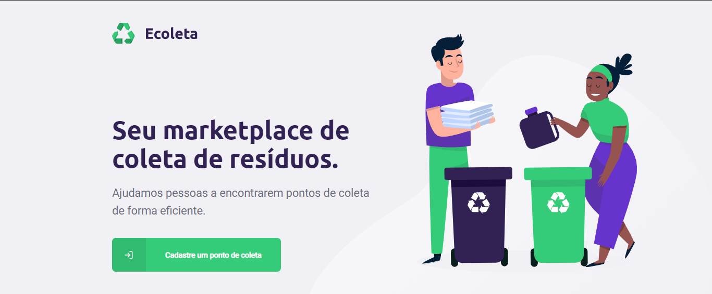
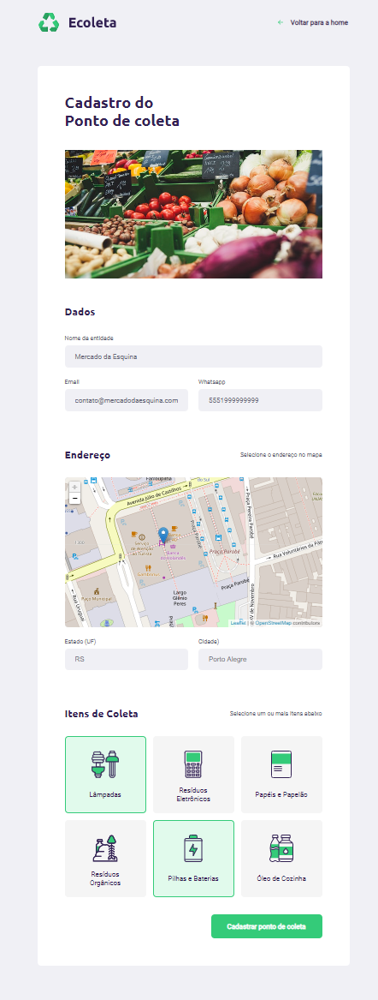
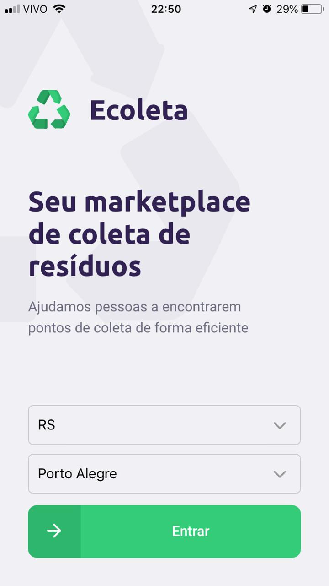
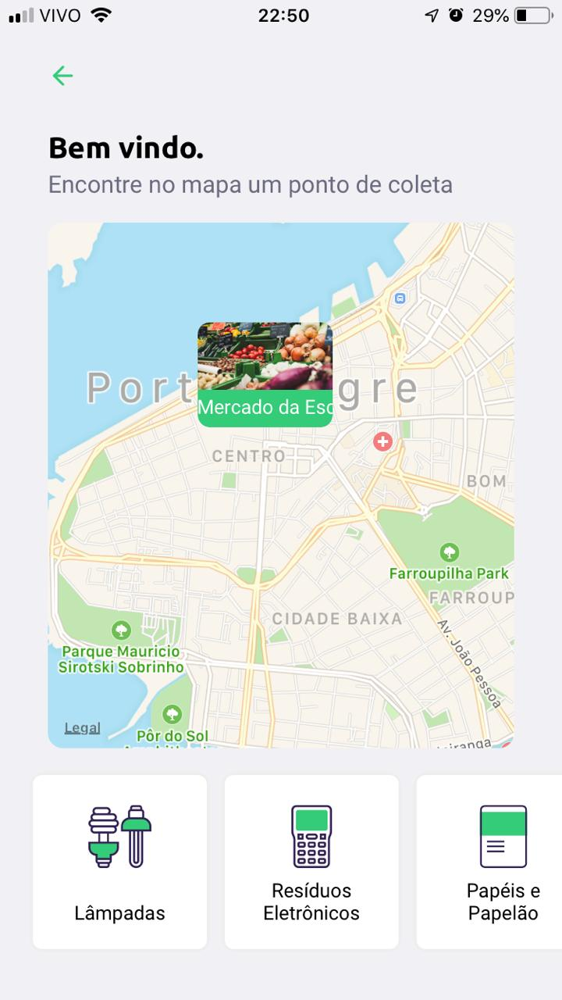
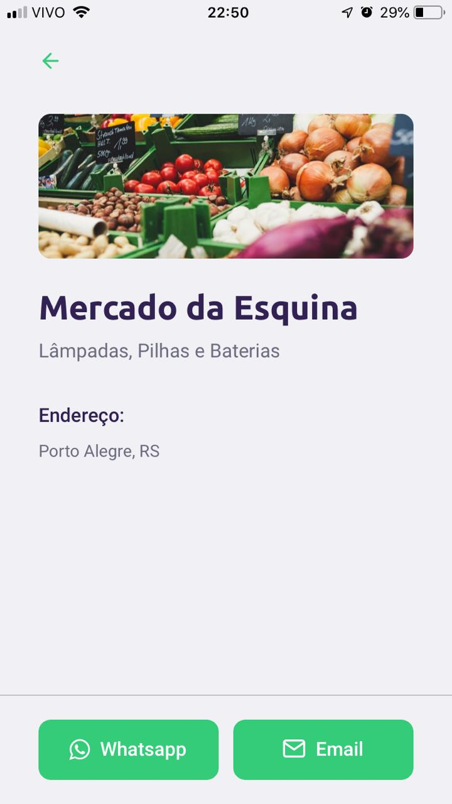

# Ecoleta ♻️

> **No longer deployed.** This ran at `ecoleta.rafaaudibert.dev`, with the frontend on
> Vercel and a serverless backend (API Gateway, Lambda, DynamoDB, S3) on AWS, until
> September 2026 when the AWS account was decommissioned. Neither the site nor the API
> resolves any more. The code is kept for reference.

Application for companies which collect recyclable materials to register, so that people in need of those companies can find them easily.

This application was developed through the [Rocketseat](https://rocketseat.com.br/) NLW #01, but with some big changes from the proposed project on the Backend part, using Serverless technologies.

The application used to be available at `ecoleta.rafaaudibert.dev`. The deployment notes below describe how it was wired up, and are kept for reference rather than as current instructions.

## Architeture 📐

Everything is built using [Typescript](https://www.typescriptlang.org/), from the backend, through the Desktop and Mobile application.

The code was deployed automatically using [Github Actions](https://github.com/features/actions) on push to master. That workflow has been removed.

The app is not available on the stores, but can be easily accessed using Expo and running `npm start` on `mobile` folder and following Expo steps.

### Backend 💾

This application backend is built with serverless technologies (and [Serverless](https://www.serverless.com/) framework), more specifically on top of [AWS](https://aws.amazon.com/), namely:

* [AWS Lambda](https://aws.amazon.com/lambda/), for code execution;
* [AWS DynamoDB](https://aws.amazon.com/dynamodb/), for long term storage;
* [AWS S3](https://aws.amazon.com/s3/), for storing images and assets.

The backend is queried both from the web frontend and the mobile app through a common interface, resulting in a general API.

### Web Frontend 💾

A simple React application, responsible for the application data input. Props to some of the awesome technologies used:

* [Dropzone](https://www.dropzonejs.com/) with [Dropzone React](https://react-dropzone.js.org/)
* [Leaflet](https://leafletjs.com/) with [Leaflet React](https://react-leaflet.js.org/)

The frontend is deployed using [Vercel](https://vercel.com/), and is available [here](https://ecoleta.rafaaudibert.dev).

### Mobile app 📱

[React Native](https://reactnative.dev/) Typescript mobile app, built using [Expo](https://expo.io/) for local testing (and some awesome extra libraries). Responsible for displaying the information registered through the web form.

## Screenshots 📷

### Desktop

### Mobile

## Author 🧔

* [RafaAudibert](https://rafaaudibert.dev)
